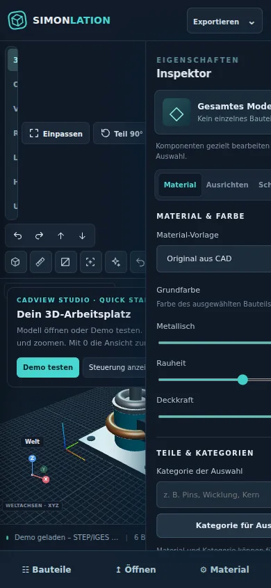
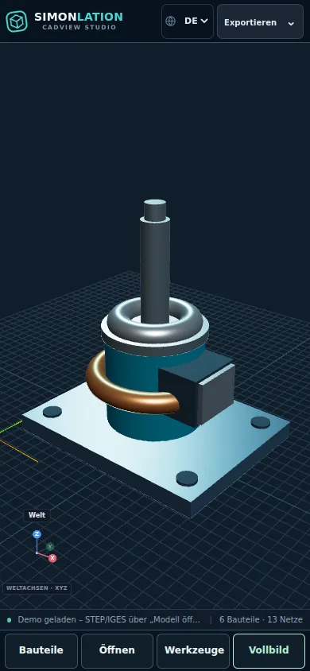

# CADVIEW auf dem Smartphone · Entwicklungsstand 22. November 2026

## Ausgangspunkt und Bedienkonzept

CADVIEW main 5ff9e6c (Beta 1.5.0), SIMONLATION-Website main 9264c8e (hub.css). Der Viewer läuft als statische ES-Modul-App. app.js besitzt Kamera, Z-Hochachse, Picking, Messpunkte, Materialien und Exporte. gui.js schaltet Inspektor-Tabs. Das Manifest hat die eigene ID und den Scope /cadview-studio/. Der Worker lädt OCCT zunächst vom eigenen Ursprung. Bei einem Fehler versucht die bisherige Version zwei CDNs für die Engine. Modelle werden dem Worker lokal übergeben.

| Ansicht | Befund im Ausgangscode | Ziel für den ersten Branch |
| --- | --- | --- |
| Smartphone hochkant | Mehrzeilige Maus-Werkzeugleiste, Willkommenskarte, seitliche Schubladen. Der gespeicherte Tab kann den Inspektor beim Start öffnen. | Kopfzeile mit Dateiaktionen, freie Modellfläche, Fußleiste mit Teilen, Öffnen, Werkzeugen und Vollbild. Baum und Inspektor als überlagernde Sheets. |
| Smartphone quer | Schubladen und Toolbar verbrauchen einen großen Teil der Höhe. | Dasselbe Bedienmodell mit voller Breite und höhenbegrenztem, scrollbar bedienbarem Sheet. |
| Tablet | Zwischen den vorhandenen Breakpoints fehlen erreichbare Aktionen für den verdeckten Inspektor. | Touch-Tablet nutzt dieselben Werkzeuge, große Desktop-Fenster behalten die drei Arbeitsbereiche. |
| Vollbild | Keine integrierte Inspektion mit Sensorsteuerung. | Kopf mit permanentem Zurück, experimentellem Gyro und Zentrieren. Modell und Teileaktionen darunter. CSS-Fokus sofort, natives Vollbild als Ergänzung. |
| Desktop | Linkszug, Rechts-/Mitteltastenzug, Mausrad, expliziter Geometrie-Modus, Messungen, Projektdaten und lokale Exporte. | Bestehende Aktionen und Datenpfade behalten. Vollbild als zusätzliche Ansicht. |

Die mobile Werkzeugleiste verwendet Navy #101e2a, Night #06121f, Mint #b7f0d4 und bei hellem Thema Paper #f0f3f0, Ink #172a2b und Green #17614c. Systemschrift wie in der Website. Markenbilder verbleiben im Website-Repository.

## Architektur und Reihenfolge

1. Maus und Stift behalten ihre Eingabezuordnung. Touch hat exklusiv einen Pointer-Router an der Interaktionsfläche. Eine zweite Berührung beendet die Tap-Kandidatur bis beide Finger abgehoben sind. Maximale Auslenkung entscheidet auch beim Rückweg zum Ausgangspunkt. Sheets verwenden die bestehenden Eingabeelemente und dürfen normal scrollen.
2. Eine DOM-/WebGL-Szene für alle Ansichten. Größenwechsel laufen über den vorhandenen ResizeObserver. Sofort-Redraw für Selektion, Sichtbarkeit, Schnitt, Explosion und Zoom bleibt erhalten. Den etablierten Wiederanlauf erst nach separater PWA-Messung auf bedarfsgesteuertes Rendering umbauen.
3. Relativer Gyro-Orbit um den aktuellen Pivot. Kalibrieren bei Start, Drehung des Displays und Wiederaufnahme. Sensordaten nur während der aktiven Inspektion, ohne Speicherung. Zwei-Finger-Zoom und Pan verändern Abstand und Pivot weiterhin. Look-Around mit fester Kameraposition ist eine eigene spätere Ausbaustufe.
4. Prototyp mit fester Fußleiste und einem Sheet gleichzeitig. Drag-Snap-Höhen, Fokus-/Sichtbarkeitsverlauf, virtueller Baum, Doppeltap und Messlupe nach Tests mit realen Baugruppen priorisieren. Die frühen Tests entscheiden, ob eine schwebende Werkzeuggruppe im Querformat bessere Reichweite bietet.

## Prüfplan und Freigabe

| Abdeckung der Übergabe | Prüfung |
| --- | --- |
| M01–M09, M21, M24 | 360/390/430 px, Querformat und Touch-Tablet. Scrollgrenzen, geschlossene Startpanels, Tap/Drag, Pinch/Pan, Selection, Mehrfachauswahl, Sichtbarkeit, Licht/Sprache, Messpunkte, Schnitt und Explosion. |
| M10–M17, M25 | Vollbild und Rückweg mit Zustandserhalt, verweigerter Vollbildaufruf, relative Sensordaten, Zentrieren, Pinch, Unterbrechung und ausbleibende/verweigerte Freigabe. Hardware separat protokollieren. |
| M18–M20, M22–M23 | Lokaler STEP-Import mit Worker/WASM, erneuter Import offline nach Aufwärmen, GLB/PNG, Desktop-Suite, Edge-Dateistart und PWA-Update von 1.5.0. |
| Reale Freigabe | Android Chrome und Samsung Internet, iPhone Safari und Homescreen, Edge PWA. Gerät, OS/Browser, Datei, Richtung, beobachtetes Verhalten erfassen. Größere Baugruppe und thermischen Langzeittest lokal durchführen. |

Kein Merge oder Deployment vor Gerätefreigabe. Manifest, Dateihandler, Projektschema und bestehende Speicherschlüssel beibehalten. Beim Arbeitsstand eigene versionierte Shell-Dateien konsistent cachen. Vor Release Update mit offenem Projekt und bereits gewärmter OCCT-Engine prüfen.

## Bildvergleich mit der eingebauten Demo

Gleicher Modellstand, frische Browserprofile, gleiche Fenstergrößen. Auf dem Smartphone überdeckten der automatisch geöffnete Inspektor, die Begrüßung und die Mauswerkzeuge die Baugruppe. Im neuen Startbild bleibt die Baugruppe vom Sockel bis zum Kern sichtbar. Die Schaltfläche „Bauteile“ öffnet den Baum, „Werkzeuge“ den Inspektor. Auf dem Desktop bleiben beide Seitenleisten sichtbar.

| Ansicht | Beta 1.5.0 | Entwicklungsbranch |
| --- | --- | --- |
| Smartphone · 390 × 844 |  |  |
| Querformat · 844 × 390 | [Screenshot](mobile/landscape-before.webp) | [Screenshot](mobile/landscape-after.webp) |
| Tablet · 820 × 1180 | [Screenshot](mobile/tablet-before.webp) | [Screenshot](mobile/tablet-after.webp) |
| Desktop · 1600 × 940 | [Screenshot](mobile/desktop-before.webp) | [Screenshot](mobile/desktop-after.webp) |

Die Vergleichsbilder stammen aus Chromium/SwiftShader. Die beiden Läufe dokumentieren den Ausgangszustand und die erste Implementierung.

- [Referenzlauf mit unverändertem Anwendungscode](https://github.com/simmark/cadview-studio/actions/runs/45020562571)
- [Erster Lauf mit mobiler Oberfläche](https://github.com/simmark/cadview-studio/actions/runs/45020836257)
- [WebGL, mobile Interaktion und Offline-STEP](https://github.com/simmark/cadview-studio/actions/runs/45020936509)
